# 🤖 AI Reception Pro V18

AI-powered digital reception and appointment management platform for businesses and their clients.

AI Reception Pro brings appointment scheduling, customer management, AI-assisted reception, communication and administration into a unified experience, with dedicated **Administrator** and **Client** interfaces.

**Angular 19 · TypeScript · Ionic 8 · Capacitor 7 · Python · SQLite · Android**

---

## Application Preview

Explore the main workflows through real application screenshots. Demo data is shown; sensitive contact details and invitation links are obscured.

### Administrator Workspace

| Dashboard | Services | Business Settings |
|---|---|---|
| [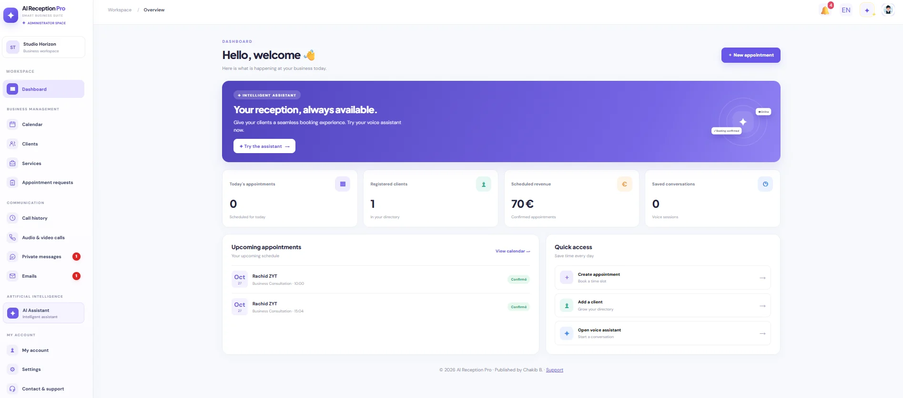](screenshots/dashboard.webp) | [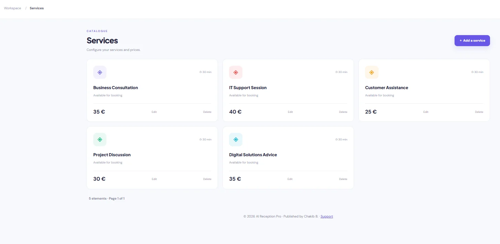](screenshots/services.webp) | [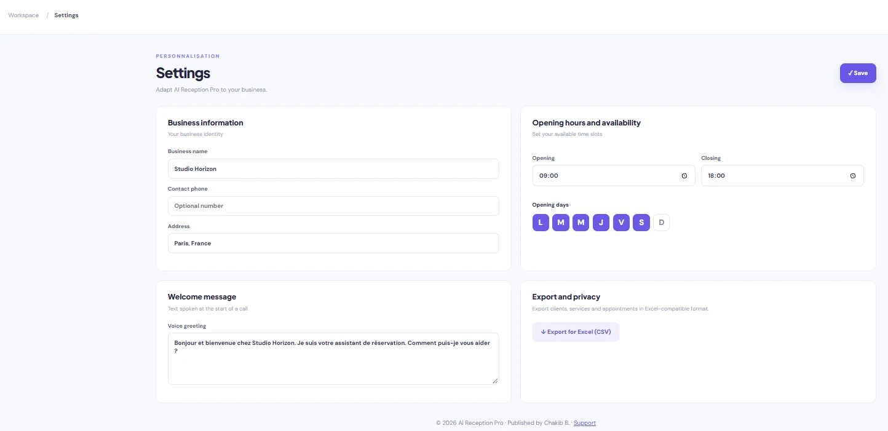](screenshots/settings.webp) |

| Client Directory | Notifications | Professional Messaging |
|---|---|---|
| [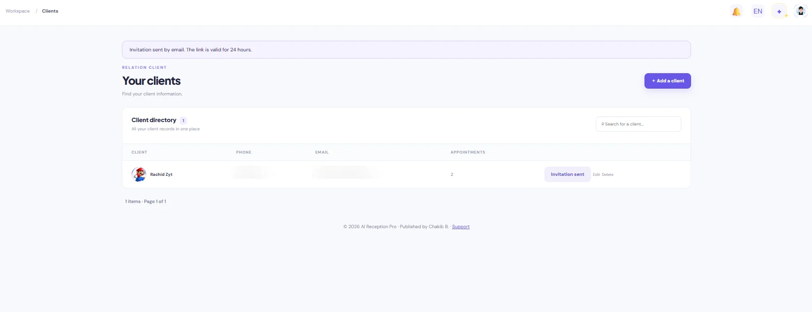](screenshots/client-directory.webp) | [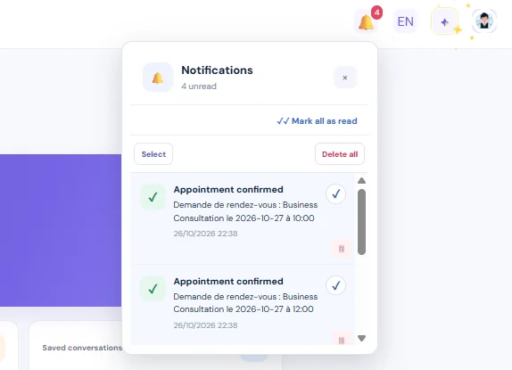](screenshots/notifications.webp) | [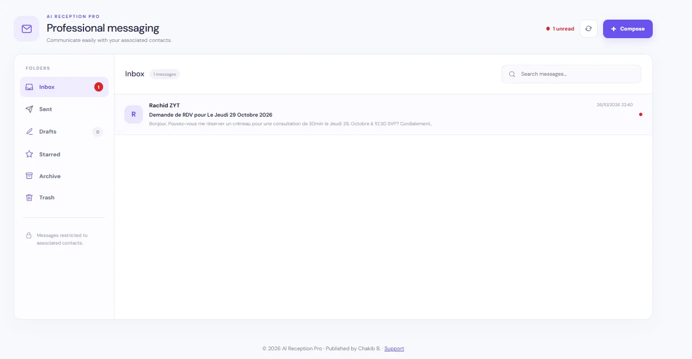](screenshots/professional-email.webp) |

### Client Experience

| Account Activation | Client Profile | Invitation Email |
|---|---|---|
| [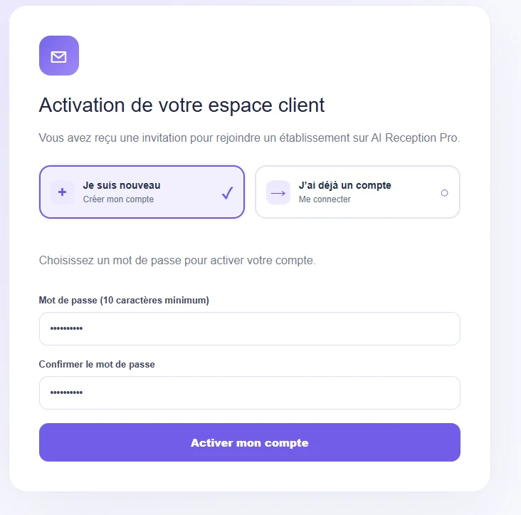](screenshots/activation.webp) | [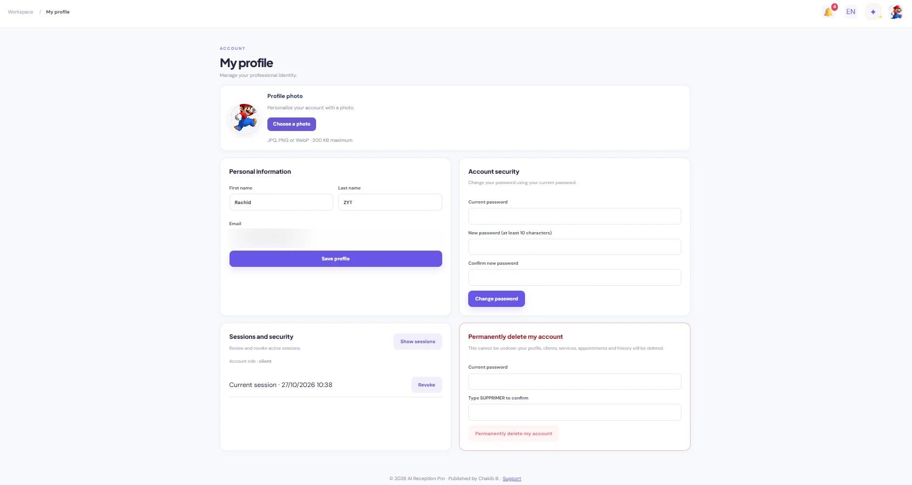](screenshots/profile.webp) | [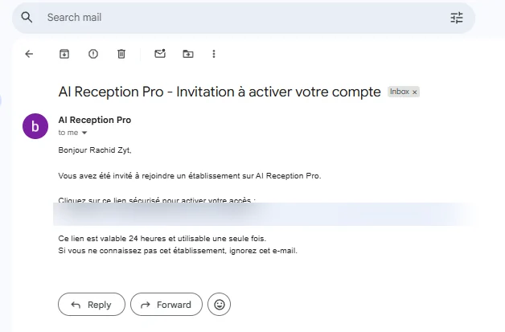](screenshots/invitation-email.webp) |

### AI & Communication

| AI Assistant | Private Messages | Audio Call |
|---|---|---|
| [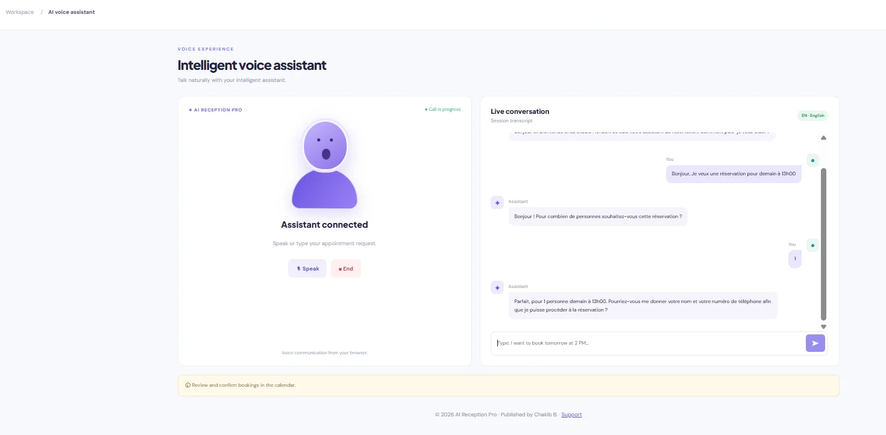](screenshots/ai-assistant.webp) | [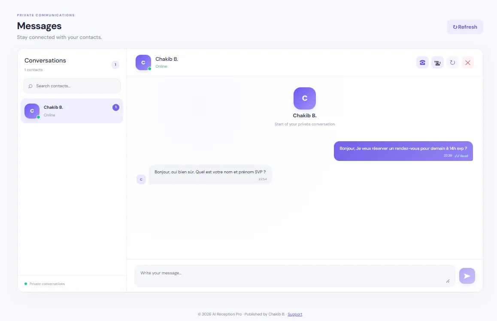](screenshots/private-messages.webp) | [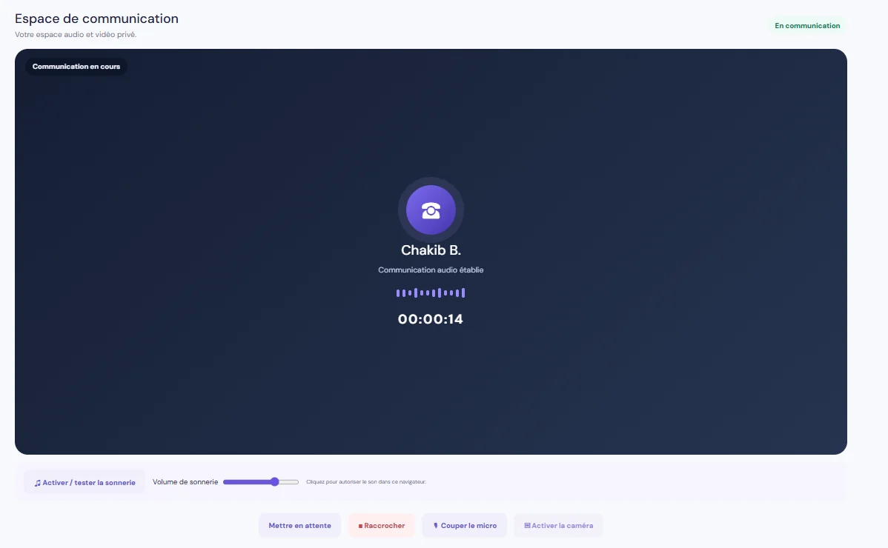](screenshots/audio-call.webp) |

| Incoming Call | Call History & Recording |
|---|---|
| [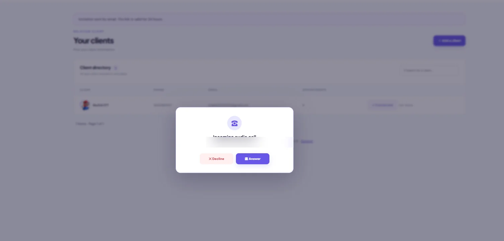](screenshots/incoming-call.webp) | [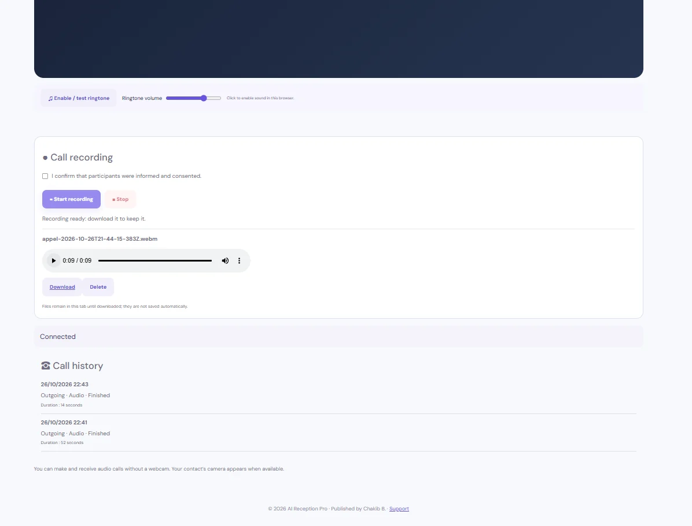](screenshots/call-history.webp) |

---

## Overview

AI Reception Pro is designed to simplify daily reception activities, appointment organization and customer interactions. It combines a business management workspace with a dedicated client experience accessible through Android applications.

### Core Capabilities

- Administrator dashboard and business overview
- Appointment calendar and booking request management
- Customer and service management
- Client appointment booking and appointment history
- AI voice assistant and conversation history
- Audio and video communication interfaces
- Private messaging and professional email management
- Application settings and support
- Dedicated Administrator and Client Android applications
- Responsive interface and multilingual functionality

---

## Administrator Dashboard

The administrator workspace centralizes access to the main business modules and day-to-day reception activities.

---

## Appointments & Calendar

The scheduling interface helps administrators organize appointments, review requests and manage booking workflows.

---

## Customer & Service Management

Dedicated interfaces provide customer records and service organization within the administration workspace.

---

## AI Reception Assistant

An AI-oriented reception interface supports conversational interactions. Conversation history can be accessed through a dedicated administration section. Available AI functionality depends on the configured environment and services.

---

## Communication

AI Reception Pro includes interfaces for audio/video calls, private messaging and professional email workflows.

---

## Client Application

The dedicated Client experience provides appointment booking, appointment consultation and access to supported assistant functionality.

---

## Technology Stack

| Layer | Technologies |
|---|---|
| Frontend | Angular 19, TypeScript, Ionic 8, RxJS |
| Mobile | Capacitor 7, Android |
| Backend | Python API |
| Database | SQLite |
| Integrations | Configurable AI, messaging and email services |

---

## Architecture

```text
Administrator Application       Client Application
        |                               |
        +---------------+---------------+
                        |
                 Python Backend API
                        |
                    SQLite
                        |
          Configurable external services
```

The Angular/Ionic applications communicate with the Python backend, which provides business logic and persistence. Mobile distribution uses Capacitor and separate Android variants.

---

## Security

The application includes authentication and distinct Administrator/Client experiences. Deployment configuration, access controls, data isolation and security should be assessed for each environment. Credentials and user data are not included in this public showcase.

---

## Responsive Design & Mobile Experience

The interfaces are designed for modern web and Android usage, with dedicated navigation for the Administrator and Client experiences.

---

## Project Status

AI Reception Pro V18 is an actively developed application. The main reception, appointment, customer management and communication modules are represented in the project.

---

## Source Code

This repository is a public showcase of AI Reception Pro, intended to present the project, its architecture and its main features.

The complete application source code is maintained privately.

Source code can be made available on request for professional review or recruitment purposes.

---

## Author

**Chakib B.**  
Software Developer

Designed and developed across frontend, backend, database integration, Android application development and deployment.

---

© 2026 AI Reception Pro
