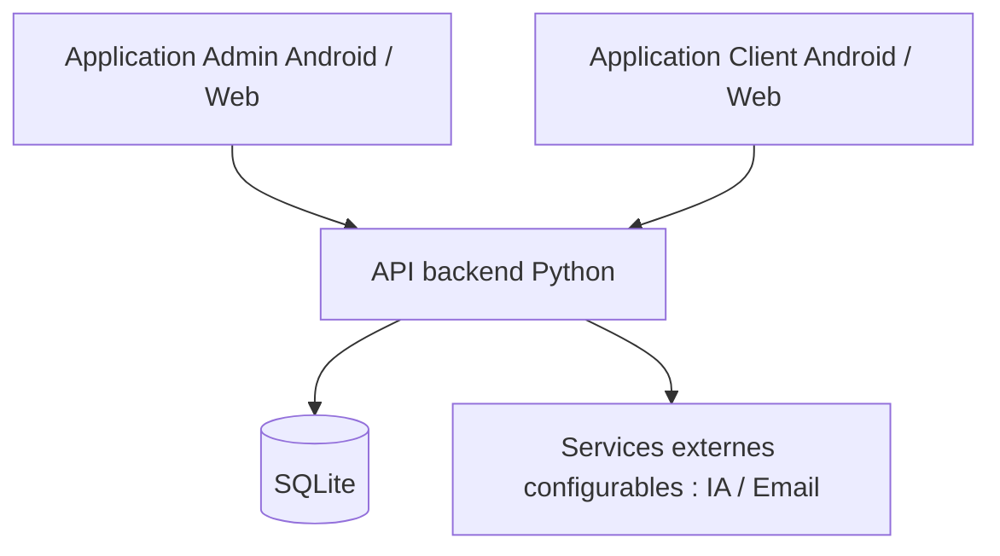

# AI Reception Pro V18
### Business reception, appointments and customer management — Android & Web

**Projet vitrine / Portfolio showcase — Code source commercial privé**

AI Reception Pro est une solution de réception numérique avec deux expériences distinctes : une interface **Administrateur** pour gérer l'activité et une interface **Client** pour accéder aux services proposés. Le projet est développé avec **Angular 19, Ionic 8, Capacitor 7**, et un backend **Python / SQLite**.

> **Statut :** démonstration de projet et présentation commerciale. Le dépôt public ne contient ni le code source intégral, ni les clés, ni les bases de données, ni les fichiers d'installation destinés aux acheteurs. Le déploiement autonome chez un acheteur reste à valider.

## Fonctionnalités présentées

| Interface Admin | Interface Client |
|---|---|
| Tableau de bord / vue d'ensemble | Réservation de rendez-vous |
| Agenda et demandes de rendez-vous | Consultation de ses rendez-vous |
| Gestion des clients et prestations | Assistant vocal IA (selon configuration) |
| Assistant vocal IA et historique | Accès aux fonctions autorisées du compte |
| Appels audio/vidéo, messagerie, emails | Expérience Android dédiée |
| Paramètres et support | |

Certaines fonctionnalités nécessitent un serveur, une configuration et des services tiers. Leur disponibilité dépend de l'environnement déployé.

## Architecture générale

**Technologies :** Angular 19 · Ionic 8 · Capacitor 7 · TypeScript · Python · SQLite · Android / Gradle.

## Aperçus

Les captures d'écran seront ajoutées après vérification et anonymisation. Aucun compte réel, donnée client, URL privée ou secret ne doit apparaître dans les images.

| Admin | Client |
|---|---|
| Capture à ajouter | Capture à ajouter |

## Vente / Commercial licensing

Le **code source complet peut être proposé sous contrat commercial**, avec les variantes Admin/Client et la documentation utilisateur, installation et architecture (FR/EN). Les conditions, le périmètre de livraison, le prix, la propriété intellectuelle et le support doivent être définis par écrit avant toute vente.

**Le code source n'est pas public.** Aucune licence open source n'est accordée par ce dépôt. Pour une démonstration ou une demande commerciale, utiliser les coordonnées professionnelles communiquées séparément par le vendeur.

## Documentation

- [Présentation technique / Technical overview](docs/ARCHITECTURE.md)
- [Périmètre de la livraison commerciale / Commercial delivery scope](docs/COMMERCIAL_SCOPE.md)
- [English overview](docs/README_EN.md)

## Confidentialité et sécurité

Aucune clé privée Android, mot de passe, base de données client ou configuration de production n'est fournie dans ce dépôt. Les droits des bibliothèques tierces et la conformité du déploiement doivent être vérifiés avant commercialisation.

© 2026 AI Reception Pro. Tous droits réservés, sous réserve des droits des tiers.
