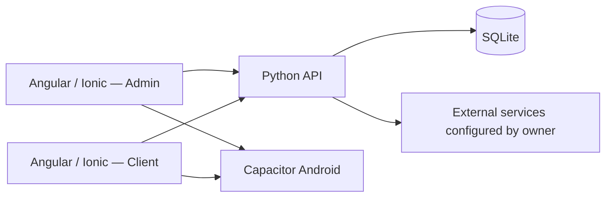

# Architecture technique — présentation publique

## Organisation logique

- **Présentation** : composants Angular/Ionic et parcours distincts pour administrateurs et clients.
- **Distribution mobile** : variantes Android Capacitor distinctes.
- **Serveur** : logique métier et points d'accès Python.
- **Persistance** : SQLite, avec isolation des données à vérifier lors de l'intégration.
- **Intégrations** : services externes selon configuration de l'exploitant.

Ce schéma est une vue simplifiée et non un dossier d'architecture de production certifié. Les modèles UML/Merise détaillés et guides d'installation restent dans le dossier commercial privé.
